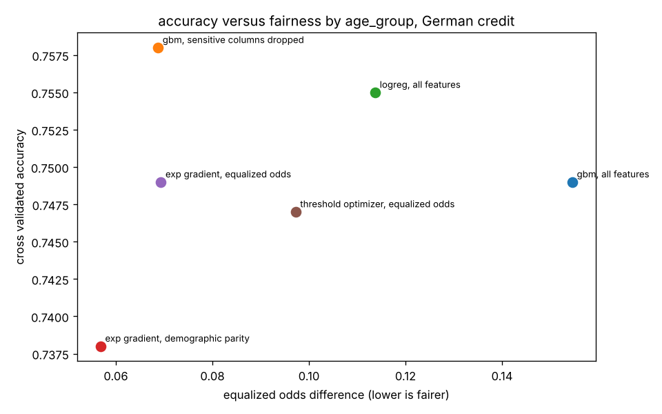

# Fairness audit of a credit approval model

A lender trains a model to approve or decline loan applications. This project asks whether that model treats women and young applicants differently from men and older applicants, measures it with the standard group fairness metrics, and tries three ways of fixing it. Everything is cross validated on the full dataset so the numbers are not an artefact of one split.

## Data

The German Credit dataset (Hofmann, UCI), 1000 applications with 20 attributes and a good or bad credit label. The file is pulled from the [jbrownlee/Datasets](https://github.com/jbrownlee/Datasets) mirror. The label is recoded so 1 means approved.

Two protected attributes are derived:

* **sex**, from the combined "personal status and sex" column
* **age group**, 25 or under versus over 25, the cut used in the fairness literature for this dataset

The base rates already differ in the data: 72 percent of men are labelled good credit versus 65 percent of women, and 73 percent of applicants over 25 versus 58 percent of those 25 or under. Any model that is accurate will reproduce some of that gap, which is the tension this whole project is about.

## Metrics

Computed with fairlearn's `MetricFrame` per group, plus two summary numbers:

* **demographic parity difference**: gap in approval rate between groups
* **equalized odds difference**: the larger of the gap in true positive rate and the gap in false positive rate, meaning how differently the model treats people who actually are good credit, and people who actually are not

## What was tried

1. gradient boosting on everything, including sex and age
2. gradient boosting with the sex and age columns removed (fairness through unawareness)
3. logistic regression on everything
4. fairlearn `ExponentiatedGradient` with a demographic parity constraint (in processing)
5. fairlearn `ExponentiatedGradient` with an equalized odds constraint
6. fairlearn `ThresholdOptimizer` with an equalized odds constraint (post processing, different decision threshold per group)

## Results

Five fold cross validated, 1000 applications.

By sex:

| setting | accuracy | approval gap | equalized odds gap |
| --- | --- | --- | --- |
| gbm, all features | 0.749 | 0.028 | 0.049 |
| gbm, sensitive columns dropped | 0.758 | 0.015 | 0.023 |
| logreg, all features | 0.755 | 0.098 | 0.138 |
| exp gradient, demographic parity | 0.734 | 0.002 | 0.039 |
| exp gradient, equalized odds | 0.739 | 0.018 | 0.006 |
| threshold optimizer, equalized odds | 0.744 | 0.022 | 0.036 |

By age group:

| setting | accuracy | approval gap | equalized odds gap |
| --- | --- | --- | --- |
| gbm, all features | 0.749 | 0.179 | 0.155 |
| gbm, sensitive columns dropped | 0.758 | 0.116 | 0.069 |
| logreg, all features | 0.755 | 0.153 | 0.114 |
| exp gradient, demographic parity | 0.738 | 0.037 | 0.057 |
| exp gradient, equalized odds | 0.749 | 0.055 | 0.069 |
| threshold optimizer, equalized odds | 0.747 | 0.119 | 0.097 |



## What it means

Sex is not where the problem is. The gradient boosting model approves women and men at almost the same rate and its error rates are close. The logistic regression is noticeably worse here, approving women 10 points less often, which is a reminder that the choice of model family is itself a fairness decision.

Age is where the problem is. The unconstrained model approves applicants over 25 about 18 points more often than younger applicants, and its true positive rate for young applicants is 12 points lower, so a young person who would in fact repay is much more likely to be declined. Dropping the age column only closes about a third of that gap, because employment length, housing and residence duration are all proxies for age. This is the standard finding that fairness through unawareness does not work.

The reductions approach closes the approval gap almost completely, at a cost of about one point of accuracy. Whether that is the right fix is not a technical question. Enforcing demographic parity here means approving young applicants at the same rate as older ones even though they default more often in this data, which shifts risk onto the lender and could be seen as unfair to the older group. Enforcing equalized odds instead says the model should be equally good at spotting creditworthy people in both groups, which most people find easier to defend. Under Canadian and US fair lending rules the question would also be whether age is a permitted factor at all, which it generally is not above a threshold.

The honest summary a model card for this system should carry: accuracy around 75 percent, large age disparity in the unconstrained version, mitigated to under 6 points with an equalized odds constraint, with the remaining disparity driven by proxies that cannot be removed without losing real signal.

## Running it

```
pip install -r requirements.txt
python audit.py
```

Takes about half a minute. Per group tables print to the console and `results/` gets `metrics.json` and the two tradeoff plots.
